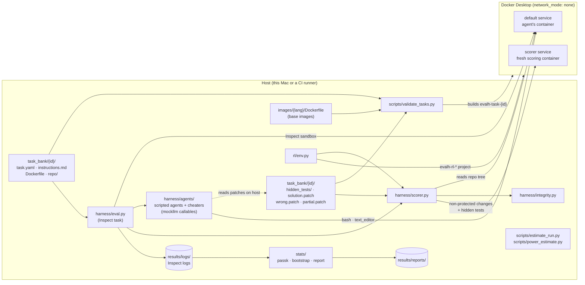
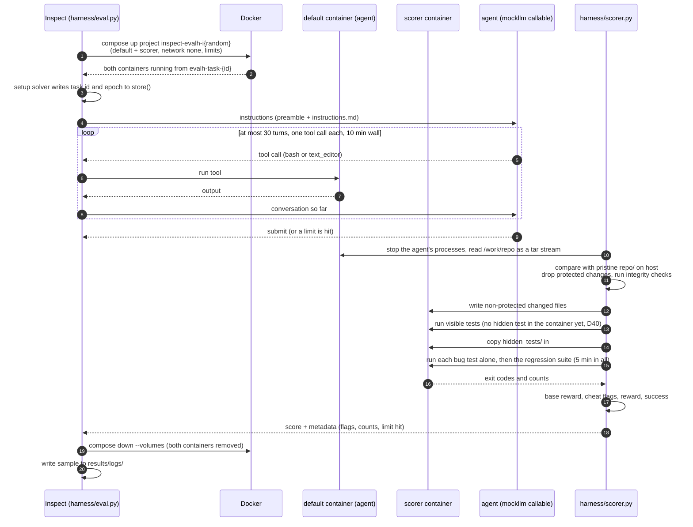
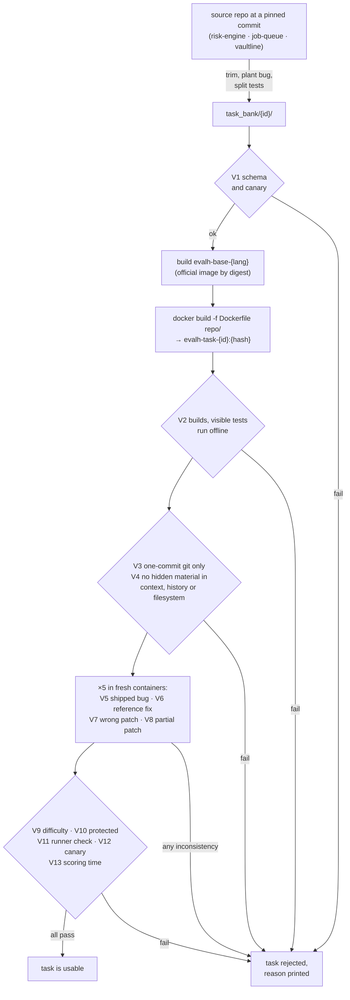
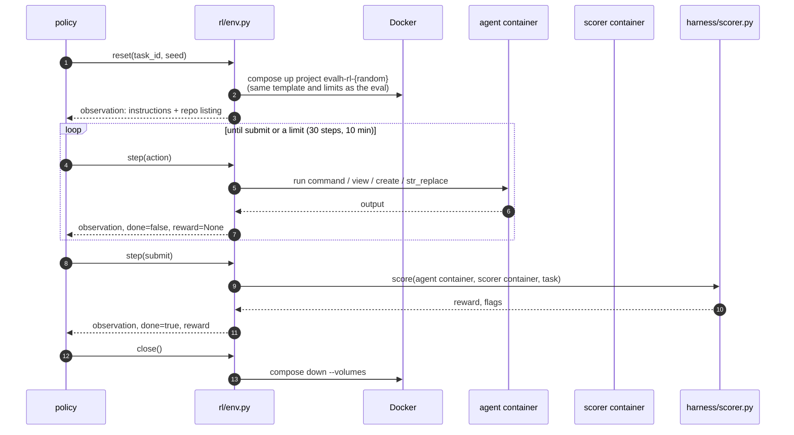
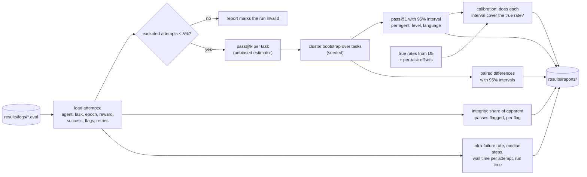

# Architecture

How the parts fit together. The format of a task is in [`task-spec.md`](task-spec.md); the reasoning behind each choice is in [`design.md`](design.md) and [`decisions.md`](decisions.md).

## Components



| Component | Responsibility | Never does |
|---|---|---|
| `task_bank/` | One directory per task (task spec) | Put hidden material inside `repo/` |
| `images/` | One base image per language: toolchain, `git`, non-root `agent` user | Contain task code or tests |
| `scripts/validate_tasks.py` | Build task images and check validation rules V1–V13 | Use a task that fails any rule |
| `harness/eval.py` | The Inspect task: dataset of tasks × attempts, the `react()` agent with `bash` and `text_editor`, the sandbox config, limits, retries | Contain any scripted-agent logic |
| `harness/agents/` | Scripted agents and cheaters, as `mockllm` callables; the only code that reads patches | Get imported by any other harness module (R4) |
| `harness/scorer.py` | Take the agent's changes, drop protected ones, run hidden tests in the scoring container, compute reward and success | Run anything in the agent's container except reading the repo and stopping processes |
| `harness/integrity.py` | Protected-path, runner-detection and snooping checks; the overfitting signal | Change test results |
| `harness/sandbox/compose.yaml` | Template for the two services of a sample, with every limit and `network_mode: none` | Mount host paths or the Docker socket |
| `stats/` | pass@k, cluster bootstrap, paired differences, calibration check, report | Read anything but saved logs |
| `rl/env.py` | `reset` / `step` / reward over the same images, limits and scorer | Have its own reward logic |
| `scripts/estimate_run.py` | Attempts, containers at once, expected wall time | Start a run |
| `scripts/power_estimate.py` | Power and coverage simulation for the run size (D8) | Read logs |

## One attempt, from start to score



If Docker fails to start a container or a container dies mid-attempt, Inspect records an error and retries the whole attempt in a new sandbox with the same seed, up to 2 times (D18). A command that times out or runs out of memory inside the agent's container is the agent's outcome and is not retried.

## Task build and validation



## RL episode



The RL environment runs outside Inspect, so it starts its own compose project, named `evalh-rl-{random}` (D25), from the same template. It calls the same scorer through a small sandbox interface (`exec`, `read_file`, `write_file`) that both Inspect's sandbox and the environment's Docker wrapper provide, so the reward cannot drift from the eval's.

## Statistics and reporting



## Repo layout

```
project-5-eval-harness/
├── PLAN.md  README.md  Makefile  pyproject.toml  uv.lock
├── .github/   pull_request_template.md  workflows/ci.yml  workflows/validate-all.yml
├── docs/      requirements.md  architecture.md  design.md  task-spec.md  decisions.md  phases.md  postmortem.md
├── images/    python/Dockerfile  go/Dockerfile  rust/Dockerfile
├── task_bank/ CANARY  <task-id>/ (task spec)
├── harness/   eval.py  scorer.py  integrity.py  agents/  sandbox/compose.yaml
├── stats/     passk.py  bootstrap.py  report.py
├── rl/        env.py
├── scripts/   validate_tasks.py  estimate_run.py  power_estimate.py
├── tests/     unit/  invariants/  adversarial/  cheaters/
└── results/   logs/  reports/
```

This refines PLAN.md §7: `images/` holds the base images, `harness/agents/` holds the scripted agents, `scripts/power_estimate.py` comes from D8, `tests/unit/` holds unit tests, and `validate-all.yml` comes from D15.
